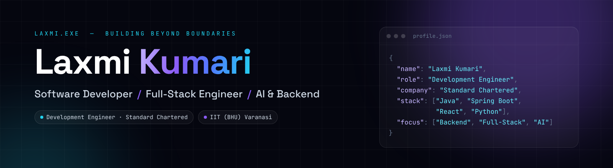
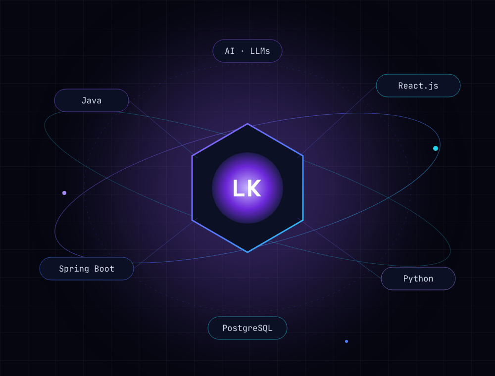
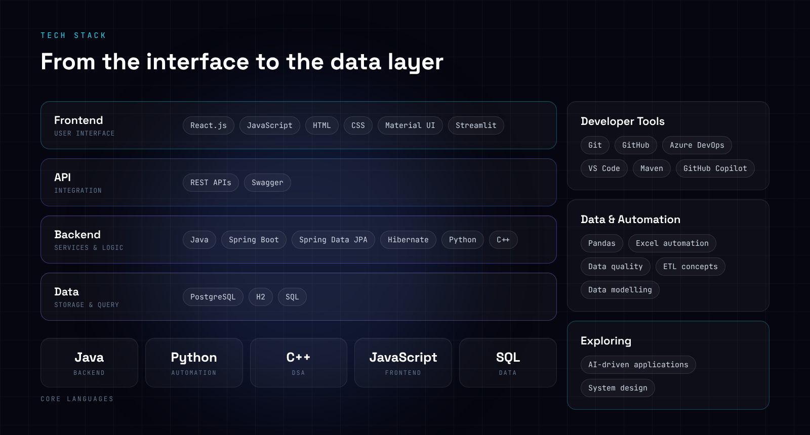
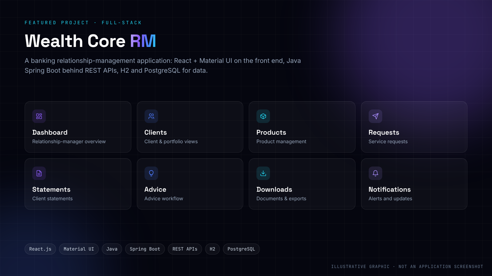
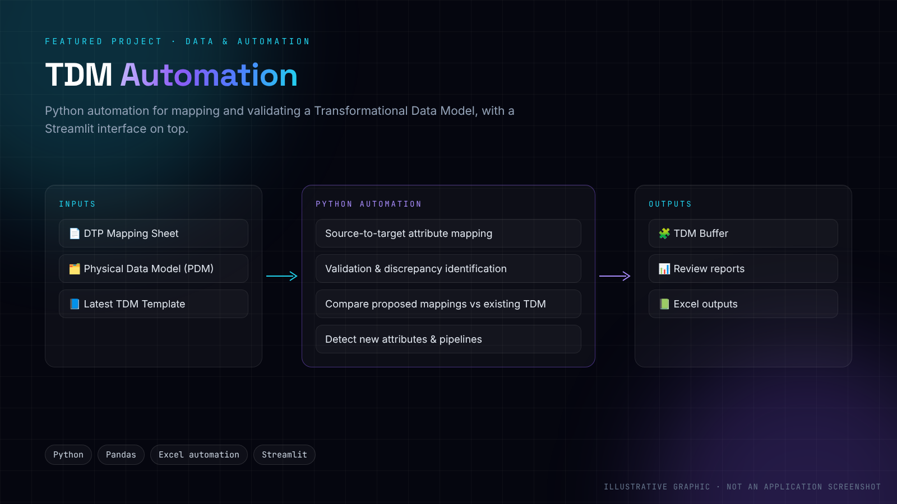
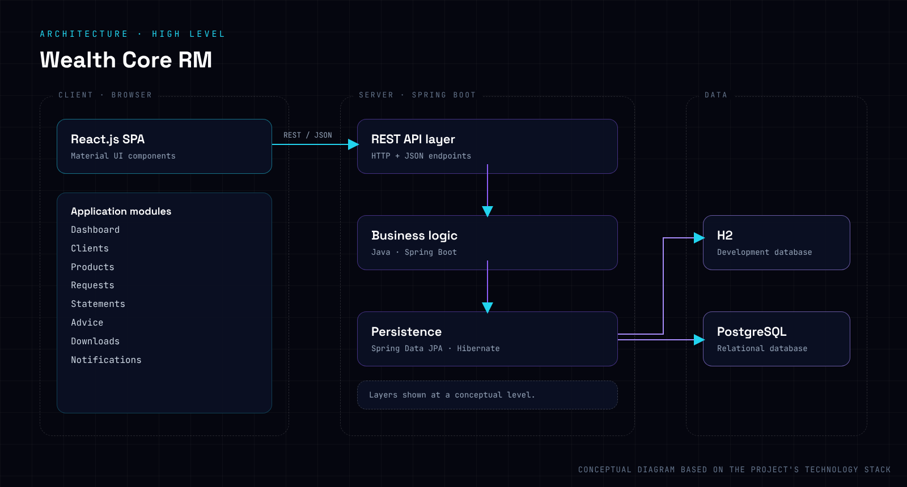
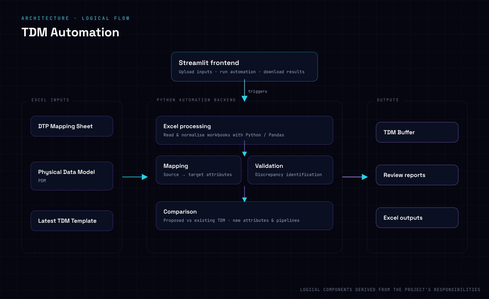

<div align="center">



<br />

<a href="https://github.com/laxmik0799"></a>
<a href="https://www.linkedin.com/in/your-linkedin-handle"></a>
<a href="mailto:your.email@example.com"></a>

<sub><code>LAXMI.EXE</code> — Building Beyond Boundaries</sub>

</div>


## ◆ Introduction

<table>
<tr>
<td width="58%" valign="top">

Hi, I'm **Laxmi Kumari**, a **Software Developer** who enjoys turning complex requirements into clean, reliable software.

I graduated from **IIT (BHU) Varanasi** with a B.Tech in Mechanical Engineering. I now work as a **Development Engineer at Standard Chartered**, building full-stack applications and data-automation tools.

My focus is **backend engineering with Java and Spring Boot**, **full-stack products with React**, and **AI-driven applications**. I like working across the whole lifecycle: designing the architecture, building and debugging, testing, and shipping.

```text
role        → Development Engineer @ Standard Chartered
education   → B.Tech, IIT (BHU) Varanasi
focus       → Backend · Full-Stack · System Design · AI
currently   → Growing into an engineer who designs, builds and ships complete products
```

</td>
<td width="42%" valign="top">

</td>
</tr>
</table>


## ◆ Professional Identity

| | |
|---|---|
| **Role** | Development Engineer |
| **Organisation** | Standard Chartered |
| **Specialisation** | Backend development · Full-stack development · Data automation |
| **Working across** | Java Spring Boot services, React front ends, Python automation |


## ◆ Education

<table>
<tr>
<td>🎓</td>
<td>

**Indian Institute of Technology (BHU), Varanasi**<br />
B.Tech in Mechanical Engineering

</td>
</tr>
</table>


## ◆ Technical Skills



| Area | Technologies |
|---|---|
| **Languages** |      |
| **Backend** |     |
| **Frontend** |      |
| **Databases** |   |
| **Tools** |        |
| **Data & Automation** |  Excel automation with Python · Data quality automation · Data modelling & ETL concepts |


## ◆ Professional Experience

<table>
<tr>
<td width="72" align="center">💼</td>
<td>

### Development Engineer · Standard Chartered
`Current`

Working on full-stack and data-automation projects, including the two featured below.

- **Full-stack development:** a banking relationship-management application built with React.js and Material UI on the front end and Java Spring Boot on the back end, connected by REST APIs and backed by H2 and PostgreSQL.
- **Data automation:** a Python solution that automates mapping and validation between a DTP Mapping Sheet, a Physical Data Model and the latest TDM template, with a Streamlit front end.

</td>
</tr>
</table>


## ◆ Featured Projects

<table>
<tr>
<td width="50%" valign="top">

<a href="projects/wealth-core-rm/README.md"></a>

### 🏦 Wealth Core RM
**Banking relationship-management application**

Client portfolio views, product management, financial insights and other banking workflows, organised into Dashboard, Clients, Products, Requests, Statements, Advice, Downloads and Notifications modules.

`React.js` `Material UI` `Java` `Spring Boot` `REST APIs` `H2` `PostgreSQL`

**[→ Read the case study](projects/wealth-core-rm/README.md)**

</td>
<td width="50%" valign="top">

<a href="projects/tdm-automation/README.md"></a>

### ⚙️ TDM Automation
**Data mapping & validation automation**

Automates mapping, validation, discrepancy identification and Transformational Data Model (TDM) template generation, with review-ready Excel reports and a Streamlit interface.

`Python` `Pandas` `Excel Automation` `Streamlit`

**[→ Read the case study](projects/tdm-automation/README.md)**

</td>
</tr>
</table>

<details>
<summary><b>🏗️ Architecture at a glance</b></summary>
<br />





</details>

> **Also building:** [**Cosmic Voyage**](https://github.com/laxmik0799/cosmic-voyage), an interactive 3D Solar System explorer made with React Three Fiber and GSAP. **[Live demo ↗](https://cosmic-voyage-teal.vercel.app/)**


## ◆ Technical Interests

| | |
|---|---|
| 🧱 **Backend engineering** | Java, Spring Boot, clean architecture and maintainable APIs |
| 🌐 **Full-stack development** | React front ends integrated with robust backend services |
| 🧭 **System design** | Scalable architectures and distributed systems |
| 🤖 **AI-driven applications** | LLM integration and AI-powered products |
| 🗄️ **Data engineering** | Data quality automation, data modelling and ETL |


## ◆ Career Goals

```text
[ 01 ]  Become a strong backend / software engineer
[ 02 ]  Build deep expertise in Java and Spring Boot
[ 03 ]  Master system design and distributed systems
[ 04 ]  Develop full-stack applications independently
[ 05 ]  Learn AI / LLM integration and build AI-powered products
[ 06 ]  Strengthen DSA and problem-solving skills
[ 07 ]  Build a strong software engineering portfolio
[ 08 ]  Explore freelance software development
```


## ◆ GitHub Activity

<div align="center">


<sub>Live cards from community-run services. They update automatically and may take a moment to load.</sub>

</div>


## ◆ Connect

<div align="center">

| Platform | Link |
|---|---|
|  | [github.com/laxmik0799](https://github.com/laxmik0799) |
|  | [linkedin.com/in/your-linkedin-handle](https://www.linkedin.com/in/your-linkedin-handle) |
|  | [your.email@example.com](mailto:your.email@example.com) |

<br />

<sub>Open to conversations about backend engineering, full-stack products and AI-driven applications.</sub>

<br /><br />


<sub>Graphics in this repository are original illustrations. Project visuals are illustrative, not application screenshots.</sub>

</div>
