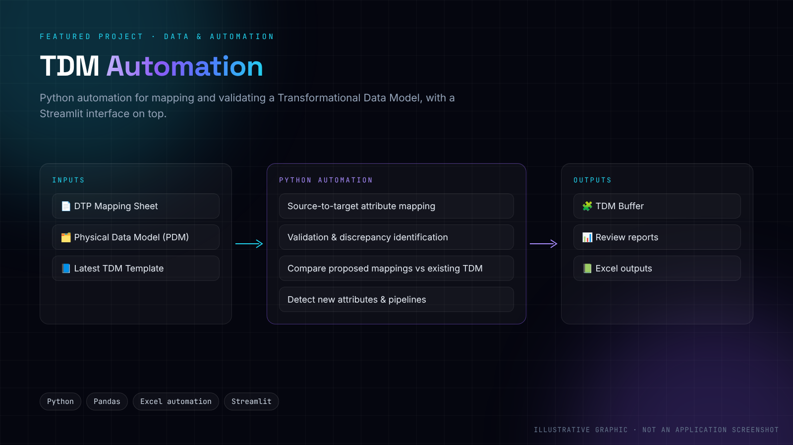
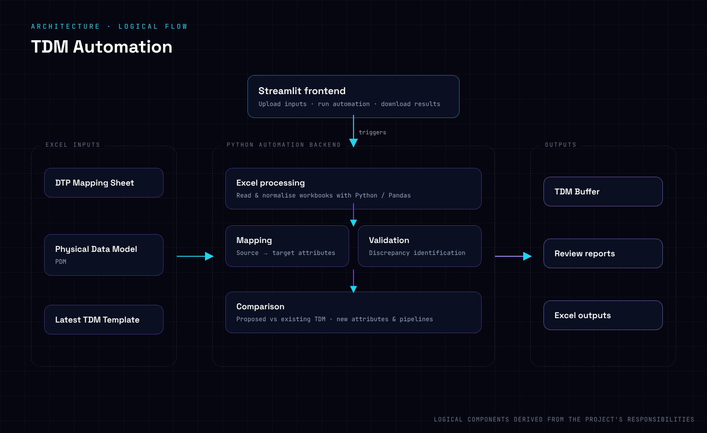
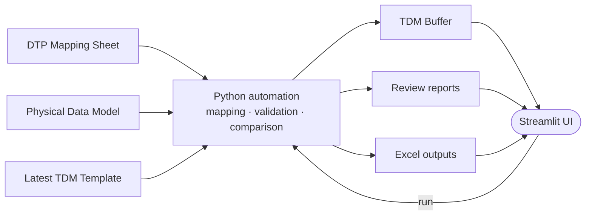

# ⚙️ TDM Automation

**Automated data mapping, validation and TDM template generation**

`Python` · `Pandas` · `Excel Automation` · `Streamlit`

[← Back to profile](../../README.md)

> [!NOTE]
> This project was built in a professional setting. This page describes it at a high level and contains no proprietary source code, data or internal system details. Visuals are illustrative, not application screenshots.

---

## Problem statement

Maintaining a **Transformational Data Model (TDM)** means reconciling several large Excel artefacts: a DTP Mapping Sheet, a Physical Data Model (PDM) and the latest TDM template. Done by hand, cross-checking mappings, spotting discrepancies and identifying new attributes is slow, repetitive and error-prone.

## Objective

Automate the mapping and validation between the **DTP Mapping Sheet**, the **Physical Data Model (PDM)** and the **latest TDM template**, and produce review-ready outputs through a simple interface.

## Technology stack

| Purpose | Technology |
|---|---|
| Automation & processing | Python |
| Data handling | Pandas, Excel processing |
| Interface | Streamlit |
| Outputs | Excel reports |

## Architecture

A Streamlit front end triggers the Python automation backend. The backend reads the Excel inputs, maps and validates attributes, compares them with the existing TDM, and writes the outputs.

> ✏️ *The component boxes are logical groupings of the work described here. Update them to match the actual module structure.*

## Features

- Excel processing and automation in Python
- Source-to-target attribute mapping
- Data validation and discrepancy identification
- Comparison of proposed mappings against the existing TDM
- Identification of new attributes and pipelines
- TDM Buffer generation
- Review reports and Excel outputs
- Streamlit front end integrated with the automation backend

## My contributions

- Developed the Python-based automation for mapping and validation across the DTP Mapping Sheet, PDM and TDM template
- Implemented source-to-target mapping, validation and discrepancy identification
- Built the comparison of proposed mappings against the existing TDM, including detection of new attributes and pipelines
- Generated the TDM Buffer, review reports and Excel outputs
- Developed the Streamlit front end and integrated it with the automation backend

> ✏️ *Adjust this list to reflect exactly which parts you owned.*

## Workflow

## Screenshots & illustrations

| Visual | Description |
|---|---|
|  | Illustrative pipeline overview (not a screenshot) |
|  | Logical architecture |

> ✏️ *Real screenshots can go in `assets/images/`, if sharing them is permitted.*

## Future improvements

Areas I'm interested in improving:

- **Architecture & modularity:** clearer separation between parsing, mapping, validation and reporting
- **Scalability:** handling larger and more numerous workbooks efficiently
- **User experience:** a more polished, guided Streamlit workflow

> ✏️ *Add specific planned changes.*

---

<a href="../wealth-core-rm/README.md">← Wealth Core RM</a> · <a href="../../README.md">Back to profile</a>

