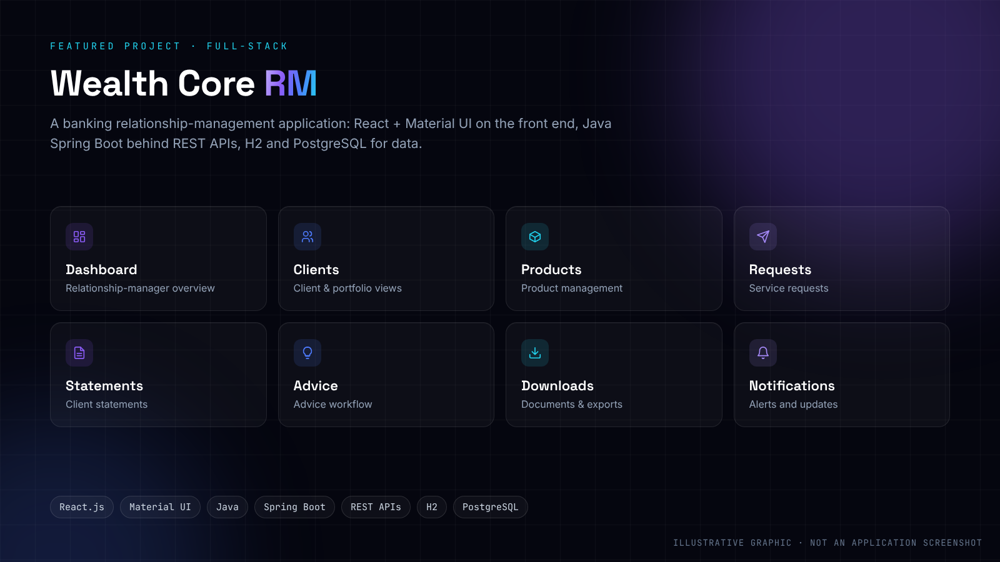
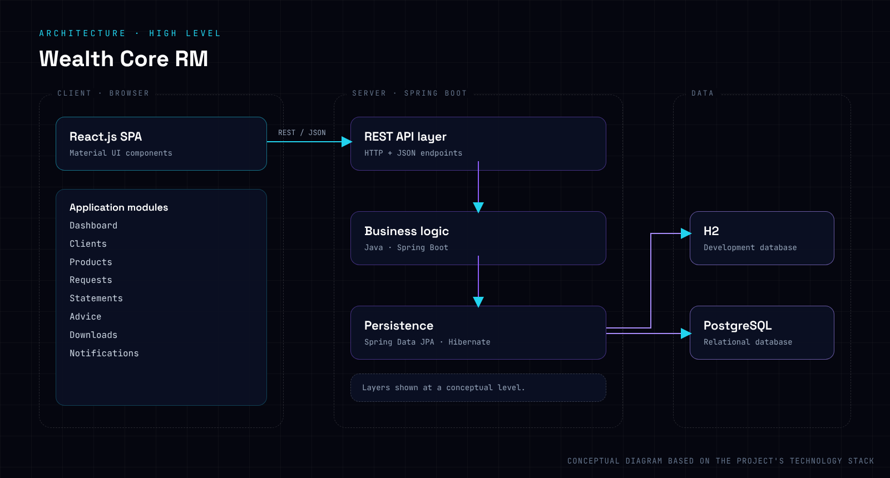
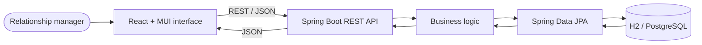

# 🏦 Wealth Core RM

**A banking relationship-management application**

`React.js` · `Material UI` · `Java` · `Spring Boot` · `REST APIs` · `H2` · `PostgreSQL`

[← Back to profile](../../README.md)

> [!NOTE]
> This project was built in a professional setting. This page describes it at a high level and contains no proprietary source code, data or internal system details. Visuals are illustrative, not application screenshots.

---

## Problem statement

Relationship managers work across many tasks: client portfolios, products, service requests, statements, advice, documents and notifications. Spreading these across disconnected tools slows them down.

> ✏️ *Add the specific business context or pain points this application addresses.*

## Objective

Bring the relationship manager's core workflows into one web application: a React interface backed by a Java Spring Boot service layer that exposes REST APIs.

## Technology stack

| Layer | Technology |
|---|---|
| Frontend | React.js, Material UI (MUI), JavaScript |
| API | REST APIs (JSON over HTTP) |
| Backend | Java, Spring Boot |
| Persistence | Spring Data JPA / Hibernate |
| Databases | H2, PostgreSQL |

## Architecture

The React single-page application calls REST endpoints exposed by the Spring Boot backend. Persistence goes through Spring Data JPA, backed by H2 and PostgreSQL.

> ✏️ *Add details such as the package/layer structure, authentication approach and how environments use H2 vs PostgreSQL.*

## Features

| Module | Purpose |
|---|---|
| **Dashboard** | Overview for the relationship manager |
| **Clients** | Client and portfolio views |
| **Products** | Product management |
| **Requests** | Service requests |
| **Statements** | Client statements |
| **Advice** | Advice workflows |
| **Downloads** | Documents and exports |
| **Notifications** | Alerts and updates |

## My contributions

- Worked on the application across the stack: React.js and Material UI on the front end, Java Spring Boot on the back end
- REST API development and frontend–backend integration
- Database work with H2 and PostgreSQL

> ✏️ *Add the specific modules, features or improvements you owned.*

## Workflow

## Screenshots & illustrations

| Visual | Description |
|---|---|
|  | Illustrative module overview (not a screenshot) |
|  | High-level architecture |

> ✏️ *Real screenshots can go in `assets/images/`, if sharing them is permitted.*

## Future improvements

> ✏️ *Add the improvements you have planned or would like to explore.*

---

<a href="../../README.md">← Back to profile</a> · <a href="../tdm-automation/README.md">TDM Automation →</a>

